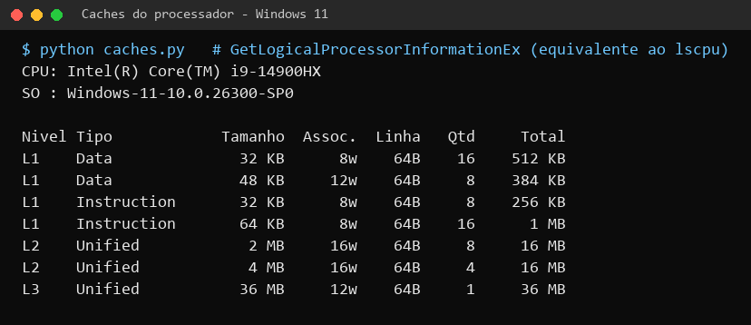

**Nome completo:** Rebeca Sbroglio | **D1 = 6** | **D2 = 4** | **N = 7**

# Ponderada CC08: do pipeline ao deadlock (pulseira Tato)

## Parâmetros individuais

| Item | Conta | Valor |
|---|---|---|
| Letras do primeiro nome | R-e-b-e-c-a | 6 |
| Letras do nome completo | Rebeca (6) + Sbroglio (8) | 14 |
| **D1** | 6 (menor que 10) | **6** |
| **D2** | último dígito de 14 | **4** |
| **IC** (instruções por amostra) | 100.000 + 20.000 × 4 | **180.000** |
| **m** (taxa de falta na L1 do SoC) | 3% + 0,5% × 6 | **6% = 0,06** |
| **N** (tamanho do buffer) | 3 + (4 mod 5) = 3 + 4 | **7** |

Requisito: cada amostra processada em **≤ 5 ms** (amostras chegam a cada 10 ms).

---

# Parte A: o problema técnico

## A1. Arquitetura e memória: qual processador vai na pulseira?

### A1.1 Plataforma H (Harvard, 48 MHz, CPI 1,5, sem SO)

```
Ciclos por amostra = IC × CPI = 180.000 × 1,5 = 270.000 ciclos
Período do clock   = 1 / 48 MHz = 20,833 ns
Tempo por amostra  = 270.000 / 48.000.000 = 0,005625 s = 5,625 ms
```

**5,625 ms > 5 ms → NÃO atende.** Estoura o limite em 0,625 ms (12,5% acima). Como não há SO nem cache, esse tempo é determinístico: é o mesmo em toda amostra, então ela falha em **todas** as amostras.

### A1.2 Plataforma V (Von Neumann, 1,2 GHz, cache L1, Linux)

**AMAT** (tempo médio de acesso à memória):

```
AMAT = tempo de acerto + m × penalidade
     = 1 + 0,06 × 120
     = 1 + 7,2 = 8,2 ciclos
```

**CPI efetivo:**

```
CPI_ef = 1,0 + (acessos por instrução × m × penalidade)
       = 1,0 + (1,3 × 0,06 × 120)
       = 1,0 + 9,36 = 10,36
```

As faltas na cache multiplicam o CPI por mais de 10: a CPU passa ~90% do tempo parada esperando a DRAM.

**Tempo por amostra (médio):**

```
Ciclos = 180.000 × 10,36 = 1.864.800 ciclos
Tempo  = 1.864.800 / 1.200.000.000 = 0,001554 s = 1,554 ms
```

**Pior caso (somando o atraso do Linux):**

```
Pior caso = 1,554 ms + 3 ms = 4,554 ms
```

**1,554 ms (médio) e 4,554 ms (pior caso) ≤ 5 ms → atende**, mas com folga de só **0,446 ms (8,9%)** no pior caso. Qualquer aumento de m (por exemplo, outro processo disputando a cache) ou de IC consome essa margem: com m = 6% basta o IC crescer ~29% (0,446 ms ÷ 1,554 ms) para estourar no pior caso.

### A1.3 Plataforma H com acelerador DSP (Lei de Amdahl)

Fração acelerada f = 0,60 (filtro); ganho na fração s = 5.

```
Speedup = 1 / ((1 − f) + f / s)
        = 1 / (0,40 + 0,60 / 5)
        = 1 / (0,40 + 0,12)
        = 1 / 0,52 ≈ 1,923

Novo tempo = 5,625 ms / 1,923 = 5,625 × 0,52 = 2,925 ms
```

**2,925 ms ≤ 5 ms → agora atende**, com folga de 2,075 ms (41,5%) e sem variação de SO: 2,925 ms é também o pior caso. Note que mesmo com um DSP infinitamente rápido o speedup máximo seria 1 / 0,40 = 2,5× (tempo mínimo de 2,25 ms): os 40% não acelerados limitam o ganho.

**Resumo A1**

| Plataforma | Tempo médio | Pior caso | Atende 5 ms? | Folga no pior caso |
|---|---|---|---|---|
| H | 5,625 ms | 5,625 ms | Não | −0,625 ms |
| V | 1,554 ms | 4,554 ms | Sim | 0,446 ms |
| H + DSP | 2,925 ms | 2,925 ms | Sim | 2,075 ms |

### A1.4 Por que a V precisa de cache e a H não?

Na Von Neumann, instruções e dados passam pelo **mesmo barramento** até uma DRAM externa que leva 120 ciclos: a 1,2 GHz a CPU ficaria quase sempre esperando a memória (gargalo de Von Neumann). A cache L1 mantém perto da CPU o que é reusado e corta o custo médio de 120 para 8,2 ciclos (AMAT).
Na H, a SRAM é interna e responde em 1 ciclo, e a arquitetura Harvard tem barramentos separados para instrução e dado, então busca e acesso a dado não competem. A 48 MHz a memória acompanha a CPU, e não há gargalo para a cache esconder.

### A1.5 Evidência da minha máquina



> Capturado no Windows 11 com um script Python que chama `GetLogicalProcessorInformationEx` (a mesma fonte de dados que o CPU-Z usa na aba Caches).

Processador **Intel Core i9-14900HX** (8 P-cores + 16 E-cores):

- **L1 dividida:** sim. Cada P-core tem **L1d de 48 KB + L1i de 32 KB**, cada E-core tem **L1d de 32 KB + L1i de 64 KB**.
- **L2 e L3 unificadas:** L2 de 2 MB por P-core e 4 MB por cluster de 4 E-cores; L3 de 36 MB compartilhada.

**Conclusão: o computador é Von Neumann (na prática, "Harvard modificada").** A L1 separada em instruções e dados é uma característica Harvard, mas só existe **dentro** do núcleo, para buscar instrução e dado no mesmo ciclo. Do L2 para baixo a cache é unificada e a memória principal (DRAM) é **uma só**, com um único espaço de endereçamento onde código e dados convivem: um programa pode ser carregado como dado e depois executado. Esse é o modelo de Von Neumann. A L1 dividida só alivia o gargalo, não muda o modelo.
