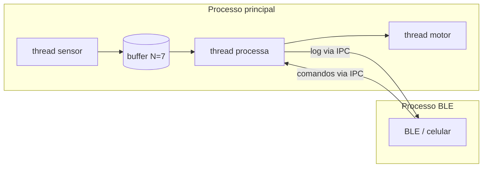
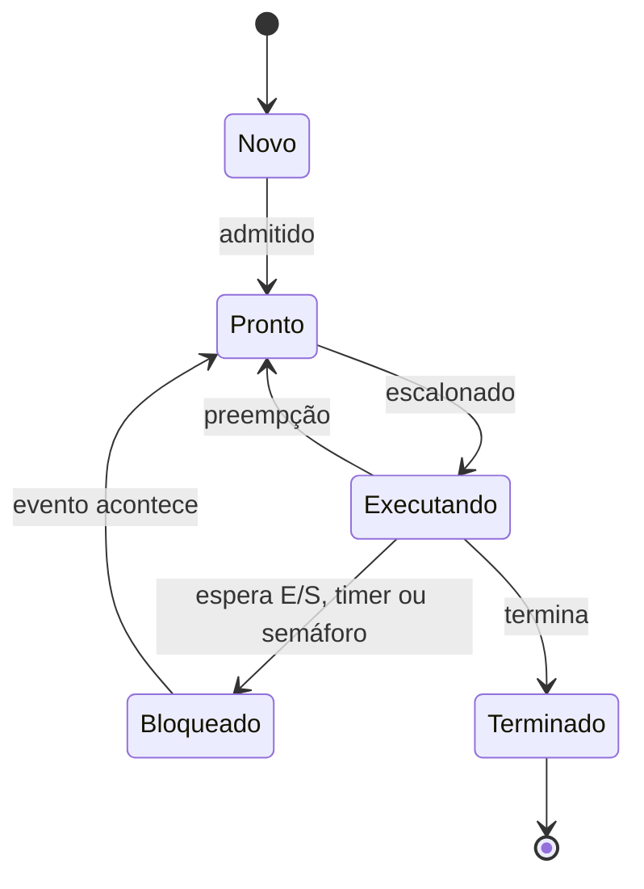
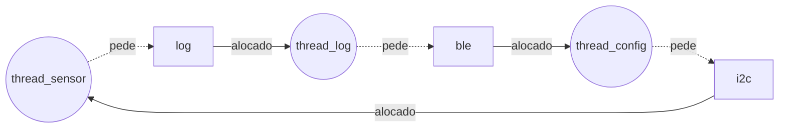

Nome completo: Rebeca Sbroglio | D1 = 6 | D2 = 4 | N = 7

# Ponderada CC08: do pipeline ao deadlock (pulseira Tato)

## Parâmetros individuais

| Item | Conta | Valor |
|---|---|---|
| Letras do primeiro nome | Rebeca | 6 |
| Letras do nome completo | Rebeca (6) + Sbroglio (8) | 14 |
| D1 | 6 (menor que 10) | 6 |
| D2 | último dígito de 14 | 4 |
| IC (instruções por amostra) | 100.000 + 20.000 × 4 | 180.000 |
| m (taxa de falta na L1 do SoC) | 3% + 0,5% × 6 | 6% = 0,06 |
| N (tamanho do buffer) | 3 + (4 mod 5) = 3 + 4 | 7 |

Requisito: cada amostra precisa ser processada em no máximo 5 ms (chega uma amostra a cada 10 ms).

---

# Parte A: o problema técnico

## A1. Arquitetura e memória: qual processador vai na pulseira?

### A1.1 Plataforma H

```
Ciclos por amostra = IC × CPI = 180.000 × 1,5 = 270.000 ciclos
Tempo por amostra  = 270.000 / 48.000.000 = 0,005625 s = 5,625 ms
```

**5,625 ms > 5 ms, então não atende.** Passa do limite em 0,625 ms. Como a H não tem sistema operacional nem cache, o tempo é sempre o mesmo, ou seja, ela estoura o prazo em todas as amostras.

### A1.2 Plataforma V

AMAT:

```
AMAT = tempo de acerto + m × penalidade
     = 1 + 0,06 × 120
     = 1 + 7,2 = 8,2 ciclos
```

CPI efetivo:

```
CPI_ef = 1,0 + (acessos por instrução × m × penalidade)
       = 1,0 + (1,3 × 0,06 × 120)
       = 1,0 + 9,36 = 10,36
```

Ou seja, por causa das faltas na cache o CPI fica mais de 10 vezes maior que o ideal.

Tempo por amostra:

```
Ciclos = 180.000 × 10,36 = 1.864.800 ciclos
Tempo  = 1.864.800 / 1.200.000.000 = 0,001554 s = 1,554 ms
```

Pior caso, somando o atraso do Linux:

```
Pior caso = 1,554 ms + 3 ms = 4,554 ms
```

**Atende: 1,554 ms em média e 4,554 ms no pior caso.** Mas a folga no pior caso é de só 0,446 ms (5 − 4,554). Se o código crescer uns 29% (0,446 / 1,554) ou a taxa de falta subir, ela deixa de atender.

### A1.3 Plataforma H com DSP (Lei de Amdahl)

Fração acelerada f = 0,6 e ganho s = 5:

```
Speedup = 1 / ((1 − f) + f / s)
        = 1 / (0,4 + 0,6 / 5)
        = 1 / (0,4 + 0,12)
        = 1 / 0,52 ≈ 1,92

Novo tempo = 5,625 ms × 0,52 = 2,925 ms
```

**Agora atende: 2,925 ms**, com folga de 2,075 ms. Como não tem SO, esse também é o pior caso.

| Plataforma | Tempo médio | Pior caso | Atende? |
|---|---|---|---|
| H | 5,625 ms | 5,625 ms | Não |
| V | 1,554 ms | 4,554 ms | Sim |
| H + DSP | 2,925 ms | 2,925 ms | Sim |

### A1.4 Por que a V precisa de cache e a H não?

Na V (Von Neumann), instruções e dados passam pelo mesmo barramento até a DRAM, que demora 120 ciclos. A 1,2 GHz o processador ficaria quase o tempo todo esperando a memória: esse é o gargalo de Von Neumann. A cache guarda perto da CPU o que é usado com frequência e derruba o tempo médio de acesso para 8,2 ciclos.
Na H, a memória é interna e responde em 1 ciclo, e instruções e dados têm barramentos separados (Harvard). A 48 MHz a memória acompanha o processador, então a cache não teria o que resolver.

### A1.5 Evidência da minha máquina


Print do CPU-Z 3.02. Nessa versão as informações de cache ficam no quadro "Cache" da aba CPU.

Meu processador é um Intel Core i9-14900HX (8 P-cores e 16 E-cores). Pelo print:

- L1 Data: 8 x 48 KB + 16 x 32 KB
- L1 Inst.: 8 x 32 KB + 16 x 64 KB
- Level 2: 8 x 2 MB + 4 x 4 MB
- Level 3: 36 MB

A L1 é dividida em instruções e dados, já que aparecem duas linhas separadas. Isso é uma ideia da arquitetura Harvard, mas só vale para a L1, dentro de cada núcleo. A L2, a L3 e a memória RAM são unificadas: código e dados ficam na mesma memória e no mesmo espaço de endereços. Por isso eu considero o meu computador Von Neumann. A L1 dividida serve para diminuir o gargalo, deixando buscar uma instrução e um dado ao mesmo tempo, mas não muda o modelo.

---

## A2. Pipeline: o loop do filtro

```asm
1 lw   x5, 0(x10)    # lê a amostra nova
2 add  x6, x6, x5    # soma += nova
3 lw   x7, 0(x11)    # lê a amostra mais antiga
4 sub  x6, x6, x7    # soma -= antiga
5 sw   x6, 0(x12)    # grava a soma
6 addi x10, x10, 4   # avança o ponteiro da nova
7 addi x11, x11, 4   # avança o ponteiro da antiga
```

Pipeline de 5 estágios. Como o banco de registradores é escrito na primeira metade do ciclo e lido na segunda, uma instrução consegue ler no ID o valor que outra está gravando no WB no mesmo ciclo.

### A2.1 Dependências RAW

| Produtora | Consumidora | Registrador |
|---|---|---|
| 1 `lw` | 2 `add` | x5 |
| 3 `lw` | 4 `sub` | x7 |
| 2 `add` | 4 `sub` | x6 |
| 4 `sub` | 5 `sw` | x6 |

As instruções 6 e 7 não dependem de nenhuma outra. Elas só escrevem em x10 e x11 depois que 1 e 3 já leram esses registradores, o que não causa bolha nesse pipeline.

### A2.2 Sem forwarding

Sem forwarding, a instrução dependente só pode fazer o ID no mesmo ciclo em que a anterior faz o WB. Quando as duas estão uma do lado da outra, isso dá 2 bolhas. Na tabela, `s` é ciclo parado.

| Instr. | 1 | 2 | 3 | 4 | 5 | 6 | 7 | 8 | 9 | 10 | 11 | 12 | 13 | 14 | 15 | 16 | 17 |
|---|---|---|---|---|---|---|---|---|---|---|---|---|---|---|---|---|---|
| 1 lw x5 | IF | ID | EX | MEM | WB | | | | | | | | | | | | |
| 2 add x6 | | IF | s | s | ID | EX | MEM | WB | | | | | | | | | |
| 3 lw x7 | | | IF | s | s | ID | EX | MEM | WB | | | | | | | | |
| 4 sub x6 | | | | | | IF | s | s | ID | EX | MEM | WB | | | | | |
| 5 sw x6 | | | | | | | IF | s | s | s | s | ID | EX | MEM | WB | | |
| 6 addi x10 | | | | | | | | | | IF | s | s | ID | EX | MEM | WB | |
| 7 addi x11 | | | | | | | | | | | | | IF | ID | EX | MEM | WB |

- O `add` espera o WB do 1º `lw` (ciclo 5): 2 bolhas.
- O `sub` espera o WB do 2º `lw` (ciclo 9): 2 bolhas. O x6 do `add` já está pronto no ciclo 8.
- O `sw` espera o WB do `sub` (ciclo 12): 2 bolhas.

```
Total = 5 + 6 + 6 bolhas = 17 ciclos
```

**Sem forwarding: 17 ciclos.**

### A2.3 Com forwarding

Com forwarding, o resultado de uma conta da ULA pode ir direto para o EX da instrução seguinte. O problema é o `lw`: o dado só fica pronto no fim do MEM, então quem vem logo depois ainda precisa esperar 1 ciclo.

| Instr. | 1 | 2 | 3 | 4 | 5 | 6 | 7 | 8 | 9 | 10 | 11 | 12 | 13 |
|---|---|---|---|---|---|---|---|---|---|---|---|---|---|
| 1 lw x5 | IF | ID | EX | MEM | WB | | | | | | | | |
| 2 add x6 | | IF | s | ID | EX | MEM | WB | | | | | | |
| 3 lw x7 | | | IF | s | ID | EX | MEM | WB | | | | | |
| 4 sub x6 | | | | | IF | s | ID | EX | MEM | WB | | | |
| 5 sw x6 | | | | | | IF | s | ID | EX | MEM | WB | | |
| 6 addi x10 | | | | | | | | IF | ID | EX | MEM | WB | |
| 7 addi x11 | | | | | | | | | IF | ID | EX | MEM | WB |

```
Total = 11 + 2 bolhas = 13 ciclos
```

**Com forwarding: 13 ciclos.** As duas bolhas que sobram são das dependências `lw x5` → `add` e `lw x7` → `sub` (load-use). O `lw` só tem o valor no fim do MEM, e a instrução seguinte precisaria dele no começo do EX, que acontece no mesmo ciclo. Como o forwarding não consegue mandar um valor que ainda não existe, a instrução tem que esperar 1 ciclo.

### A2.4 Reordenação

Subindo o segundo `lw` para logo depois do primeiro, cada `lw` fica a 2 instruções de quem usa o resultado dele:

```asm
lw   x5, 0(x10)
lw   x7, 0(x11)    # subiu
add  x6, x6, x5
sub  x6, x6, x7
sw   x6, 0(x12)
addi x10, x10, 4
addi x11, x11, 4
```

O resultado é o mesmo, porque os `lw` não dependem do `add` nem do `sub`, a ordem entre `add` e `sub` não mudou e os `addi` continuam depois dos `lw`.

| Instr. | 1 | 2 | 3 | 4 | 5 | 6 | 7 | 8 | 9 | 10 | 11 |
|---|---|---|---|---|---|---|---|---|---|---|---|
| lw x5 | IF | ID | EX | MEM | WB | | | | | | |
| lw x7 | | IF | ID | EX | MEM | WB | | | | | |
| add x6 | | | IF | ID | EX | MEM | WB | | | | |
| sub x6 | | | | IF | ID | EX | MEM | WB | | | |
| sw x6 | | | | | IF | ID | EX | MEM | WB | | |
| addi x10 | | | | | | IF | ID | EX | MEM | WB | |
| addi x11 | | | | | | | IF | ID | EX | MEM | WB |

```
Total = 5 + 6 = 11 ciclos (sem bolhas)
```

**Com a reordenação: 11 ciclos.**

---

## A3. Processos e threads: como organizar o software

### A3.1 Organização proposta

Eu dividiria em dois processos:

- **Processo principal:** três threads, uma para ler o sensor, uma para processar a amostra e uma para acionar o motor. Esse processo tem prioridade alta.
- **Processo do BLE:** separado, com prioridade normal. Recebe o log do processo principal e repassa comandos do celular, pela comunicação entre processos (IPC).



Por que assim:

- **Compartilhamento de memória:** sensor, processamento e motor trocam 100 amostras por segundo. Como threads, eles usam o mesmo buffer na memória sem precisar copiar nada. Se fossem processos, cada amostra teria que passar por IPC, e isso gasta tempo num sistema que já tem pior caso de 4,554 ms de 5 ms. O BLE só manda o log de vez em quando, então o IPC não pesa para ele.
- **Custo de criação e troca de contexto:** trocar entre threads do mesmo processo é mais barato do que entre processos, porque não precisa trocar o espaço de memória. As três threads principais trocam de contexto o tempo todo, então isso faz diferença. O BLE troca bem menos.
- **Isolamento de falhas:** se uma thread trava ou dá erro de memória, o processo inteiro cai junto. As três threads principais são código nosso e simples, então dá para deixar juntas. O BLE é a parte mais complexa e recebe dados de fora, então tem mais chance de dar problema. Separado, se ele cair, a pulseira continua vibrando e só o log para.

### A3.2 BLE como thread ou como processo

Se o BLE for uma thread e alguém explorar uma falha nele, o atacante passa a ter acesso a toda a memória do processo principal. Com isso ele pode mexer no buffer de amostras, mudar a configuração de distância ou travar o motor, e a pessoa deixa de ser avisada dos obstáculos. Ele também ganha as mesmas permissões do processo principal, que acessa o sensor e o motor.

Se o BLE for um processo separado, o sistema operacional não deixa um processo acessar a memória do outro. O atacante fica preso no processo do BLE, que pode rodar com menos permissões e sem acesso ao sensor ou ao motor. Ele só consegue mandar mensagens pelo IPC, e o processo principal pode conferir cada comando antes de aceitar. No pior caso, o log para de funcionar, mas a vibração continua.

### A3.3 Diagrama de estados



A thread do sensor passa a maior parte do tempo no estado **Bloqueado**. Ela só precisa trabalhar a cada 10 ms: acorda com o timer, lê o sensor, coloca a amostra no buffer e volta a esperar. Ler o sensor é rápido. Mesmo o processamento completo de uma amostra leva em média 1,554 ms (A1.2), cerca de 15% do período. No resto do tempo ela está esperando o próximo período ou a resposta do sensor, e não usando a CPU.

---

## A4. Código com semáforos: o buffer entre o sensor e o motor

O código está em [`codigo/`](codigo/), em Python com `threading`. O buffer tem N = 7 posições e cada execução usa 20.000 amostras. Cada script já roda as 3 execuções e mostra a tabela (como rodar está no README).

Como contei cada coisa:
- **Consumidas:** quantas leituras o consumidor fez.
- **Perdidas:** amostras de 0 a 19.999 que nunca foram lidas.
- **Duplicadas:** leituras de uma amostra que já tinha sido lida antes.
- **Travou:** se o consumidor ficou 1 s sem receber nada.

### Resultados

| Versão | Exec. | Consumidas | Perdidas | Duplicadas | Travou? |
|---|---|---|---|---|---|
| 1 (sem sincronização) | 1 | 16.864 | 3.672 | 536 | não |
| 1 (sem sincronização) | 2 | 18.104 | 2.559 | 663 | não |
| 1 (sem sincronização) | 3 | 17.010 | 3.596 | 606 | não |
| 2 (semáforos) | 1 | 20.000 | 0 | 0 | não |
| 2 (semáforos) | 2 | 20.000 | 0 | 0 | não |
| 2 (semáforos) | 3 | 20.000 | 0 | 0 | não |
| 3 (ordem trocada) | 1 | 0 | 20.000 | 0 | sim |
| 3 (ordem trocada) | 2 | 0 | 20.000 | 0 | sim |
| 3 (ordem trocada) | 3 | 0 | 20.000 | 0 | sim |

Na versão 1 se perderam em média 3.276 amostras (cerca de 16%) e umas 600 foram lidas duas vezes. Os números mudam a cada execução, porque dependem de quando o sistema troca de thread. A versão 2 não perdeu nem duplicou nada, e a versão 3 travou nas três vezes.

### Prints


### Região crítica da versão 1

A região crítica é a atualização do contador de posições ocupadas, que as duas threads alteram:

```python
# produtor                              # consumidor
lido = estado["contador"]               lido = estado["contador"]
time.sleep(0)                           time.sleep(0)
estado["contador"] = lido + 1           estado["contador"] = lido - 1
```

Atualizar o contador não é uma operação única: a thread lê o valor, faz a conta e escreve. O `sleep(0)` faz a thread perder a vez bem no meio. Por exemplo, com o contador em 3:

1. O produtor lê 3 e perde a vez.
2. O consumidor lê 3, consome uma amostra e grava 2.
3. O produtor volta e grava 3 + 1 = 4.

A atualização do consumidor se perdeu, e o contador ficou dizendo que tem mais amostras do que tem de verdade. Aí o consumidor lê posições que já tinha lido, e isso gera as **duplicadas**. Quando acontece o contrário e é a atualização do produtor que se perde, o contador fica menor do que deveria. O produtor acha que tem espaço e escreve por cima de uma amostra que ainda não foi lida, e isso gera as **perdidas**.

### O que cada semáforo garante na versão 2

- **vazio (começa em N = 7):** conta as posições livres. O produtor dá `wait(vazio)` antes de escrever, então quando o buffer está cheio ele espera em vez de sobrescrever. Por isso não há amostras perdidas.
- **cheio (começa em 0):** conta as posições ocupadas. O consumidor dá `wait(cheio)` antes de ler, então quando o buffer está vazio ele espera em vez de ler de novo uma amostra antiga. Por isso não há duplicadas.
- **mutex (começa em 1):** garante que só uma thread mexe no buffer e nos índices por vez.

Além disso, as threads ficam bloqueadas enquanto esperam, em vez de ficar em loop gastando CPU como na versão 1.

### O que aconteceu na versão 3

As três execuções travaram sem consumir nenhuma amostra. Foi um deadlock:

1. O produtor começa primeiro e enche as 7 posições do buffer, até `vazio` chegar a 0.
2. Na 8ª amostra ele pega o `mutex` e depois dá `wait(vazio)`. Como `vazio` está em 0, ele fica esperando, mas continua com o mutex.
3. O consumidor passa pelo `wait(cheio)` e tenta pegar o `mutex`. Como o mutex está com o produtor, ele também fica esperando.
4. O produtor espera o consumidor liberar uma posição, e o consumidor espera o produtor liberar o mutex. Nenhum dos dois sai do lugar, e depois de 1 s o programa registra o travamento.

Na versão 2 isso não acontece porque o produtor primeiro espera ter espaço (`vazio`) e só depois pega o mutex, então ele nunca fica parado segurando o mutex.

---

## A5. Deadlock: a pulseira congelou

```
thread_sensor:        thread_log:          thread_config:
  P(i2c)                P(log)               P(ble)
  le_sensor()           le_log()             recebe_comando()
  P(log)                P(ble)               P(i2c)
  registra()            envia()              ajusta_sensor()
  V(log)                V(ble)               V(i2c)
  V(i2c)                V(log)               V(ble)
```

### A5.1 Sequência que leva ao deadlock

1. A thread_sensor faz `P(i2c)` e consegue o I2C.
2. Troca de contexto: a thread_log faz `P(log)` e consegue o log.
3. Troca de contexto: a thread_config faz `P(ble)` e consegue o BLE.
4. A thread_sensor faz `P(log)` e bloqueia, porque o log está com a thread_log.
5. A thread_log faz `P(ble)` e bloqueia, porque o BLE está com a thread_config.
6. A thread_config faz `P(i2c)` e bloqueia, porque o I2C está com a thread_sensor.

As três ficam esperando para sempre e nenhuma chega no `V`. Como a thread do sensor está parada, a pulseira para de ler o sensor e de vibrar, e só volta depois de desligar e ligar.

Grafo de alocação de recursos nesse momento (seta cheia = recurso alocado para a thread, seta pontilhada = thread pedindo o recurso):



O grafo tem um ciclo (sensor → log → thread_log → ble → config → i2c → sensor). Como cada recurso tem uma instância só, o ciclo significa deadlock.

### A5.2 As quatro condições

| Condição | Como aparece no código |
|---|---|
| Exclusão mútua | Cada recurso (i2c, log, ble) é protegido por um semáforo binário, então só uma thread usa cada um por vez. |
| Posse e espera | Cada thread segura o primeiro recurso enquanto pede o segundo. Por exemplo, a thread_sensor segura o i2c e pede o log. |
| Sem preempção | Nada tira um recurso de uma thread. Só ela mesma pode liberar com `V`, e o `P` espera sem limite de tempo. |
| Espera circular | Cada thread pega os recursos numa ordem diferente: sensor pede i2c e depois log, log pede log e depois ble, config pede ble e depois i2c. Isso fecha um ciclo. |

### A5.3 Duas correções

**Correção 1 (prevenção): pegar os recursos sempre na mesma ordem.** Definindo a ordem i2c → log → ble, a espera circular deixa de existir. A thread_sensor e a thread_log já seguem essa ordem. Só a thread_config muda:

```
thread_config:
  P(i2c)
  P(ble)
  recebe_comando()
  ajusta_sensor()
  V(ble)
  V(i2c)
```

Para quem usa a pulseira, esse travamento não acontece mais. O lado ruim é que, enquanto a pulseira recebe um comando do celular, a thread_config já está segurando o I2C, e a leitura do sensor pode atrasar um pouco nesse momento. Como os comandos são raros, a pessoa provavelmente não percebe.

**Correção 2 (detecção e recuperação): timeout e watchdog.** Os `P` passam a ter um tempo máximo de espera. Se estourar, a thread libera o que estava segurando e tenta de novo. Além disso, um watchdog reinicia a pulseira se a thread do sensor ficar um tempo sem dar sinal de vida.

Para quem usa a pulseira, o deadlock ainda pode acontecer, mas a pulseira se recupera sozinha. Em vez de ficar travada até alguém desligar, ela reinicia, avisa com um pulso longo e fica alguns segundos sem vibrar.

A primeira resolve o problema de vez. A segunda é mais rápida de fazer e ajuda também com outros travamentos que a gente ainda não conhece.

---

# Parte B: a decisão do CTO

## Memorando ao conselho da Tato: Dilema 3 (o parceiro grande)

**De:** Rebeca Sbroglio, CTO

**Decisão: o módulo de navegação do parceiro vai rodar como processo separado, mesmo correndo o risco de perder o acordo.** Para diminuir a latência, posso oferecer acesso às amostras só para leitura, mas não acesso direto à memória do processo principal.

**Do que estou abrindo mão.** Se o parceiro desistir, perdemos a distribuição para 50 mil usuários, que seria nosso maior canal de crescimento agora. Quem paga é a empresa, que cresce mais devagar, e os usuários que teriam a navegação por voz. Também vamos ter mais trabalho de engenharia para fazer a comunicação entre os processos.

**Números da Parte A que pesaram.** Na Plataforma V, o pior caso de cada amostra é 4,554 ms, e a folga é de só 0,446 ms (A1.2). Um código fechado rodando como thread dentro do nosso processo disputa a mesma CPU e a mesma cache. Se ele fizer a taxa de falta subir de 6% para 8%, o pior caso vai para 5,02 ms, e a pulseira deixa de cumprir o requisito sem a gente ter mudado nada no nosso código. Também pesou a A4: duas threads mexendo na mesma memória sem a sincronização certa perderam cerca de 16% das amostras. Com um código que não podemos ler, não temos como garantir que isso não aconteça.

**Impacto em quem usa e risco de segurança.** A comunicação entre processos acrescenta um atraso muito pequeno perto do que um aviso de navegação precisa. Uma pessoa andando leva mais de 10 s para percorrer 20 m, então "vire à direita em 20 m" pode chegar alguns milissegundos depois sem problema. A vantagem é que, se o módulo do parceiro travar, o alerta de obstáculo continua funcionando. O risco é que a comunicação entre os processos vira um ponto de ataque: se o módulo do parceiro for invadido, ele pode mandar mensagens erradas. Para isso, o processo principal confere cada mensagem antes de aceitar, e o módulo do parceiro roda sem acesso ao sensor e ao motor. No pior caso, o usuário recebe uma instrução de navegação errada, mas o aviso de obstáculo nunca é desligado.

**O que me faria mudar de ideia.** Eu aceitaria rodar como thread se o parceiro liberar o código-fonte para auditarmos e se, num teste de 72 horas com o módulo rodando dentro do processo, o pior caso ficar abaixo de 4,0 ms, sem nenhuma amostra perdida.
