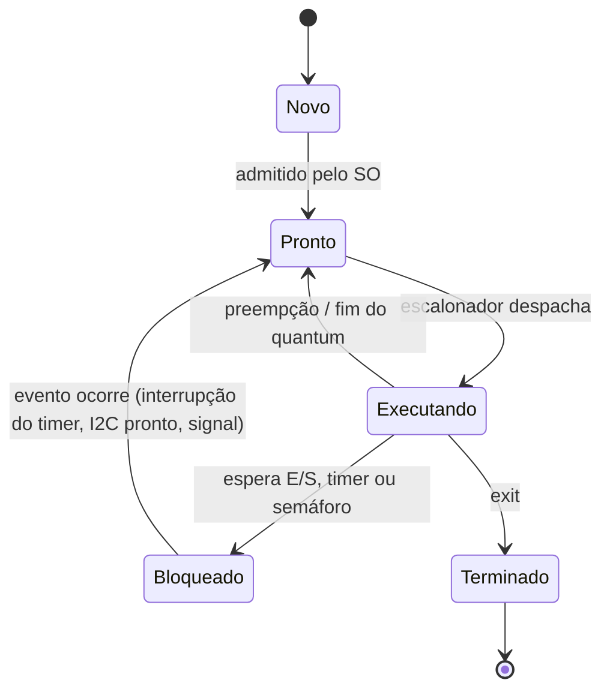
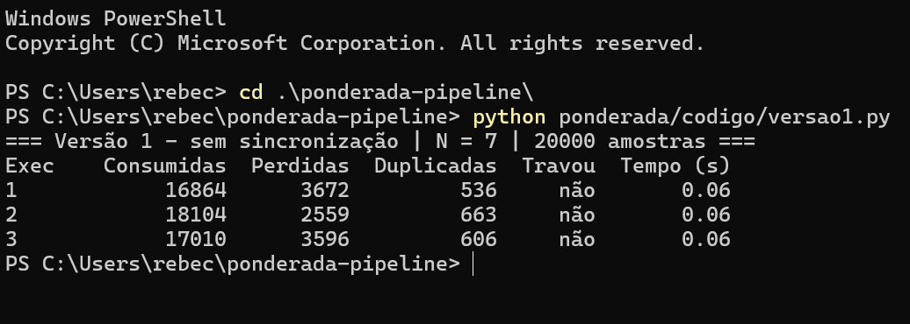
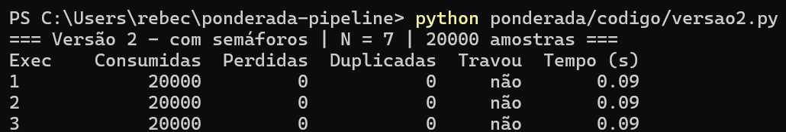
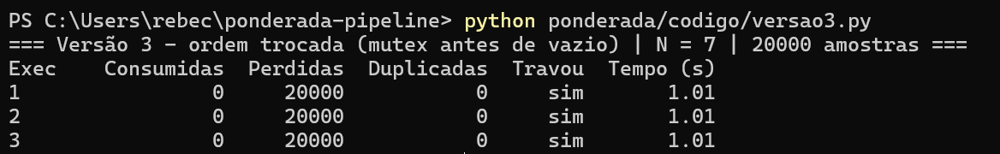
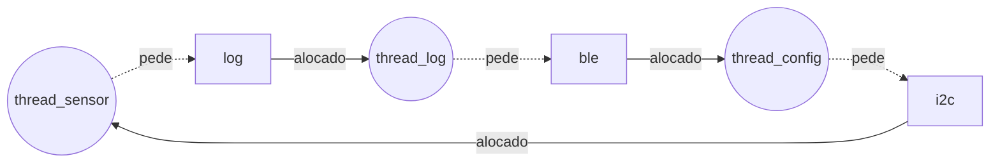

**Nome completo:** Rebeca Sbroglio | **D1 = 6** | **D2 = 4** | **N = 7**

# Ponderada CC08: do pipeline ao deadlock (pulseira Tato)

## Parâmetros individuais

| Item | Conta | Valor |
|---|---|---|
| Letras do primeiro nome | R-e-b-e-c-a | 6 |
| Letras do nome completo | Rebeca (6) + Sbroglio (8) | 14 |
| **D1** | 6 (menor que 10) | **6** |
| **D2** | último dígito de 14 | **4** |
| **IC** (instruções por amostra) | 100.000 + 20.000 × 4 | **180.000** |
| **m** (taxa de falta na L1 do SoC) | 3% + 0,5% × 6 | **6% = 0,06** |
| **N** (tamanho do buffer) | 3 + (4 mod 5) = 3 + 4 | **7** |

Requisito: cada amostra processada em **≤ 5 ms** (amostras chegam a cada 10 ms).

---

# Parte A: o problema técnico

## A1. Arquitetura e memória: qual processador vai na pulseira?

### A1.1 Plataforma H (Harvard, 48 MHz, CPI 1,5, sem SO)

```
Ciclos por amostra = IC × CPI = 180.000 × 1,5 = 270.000 ciclos
Período do clock   = 1 / 48 MHz = 20,833 ns
Tempo por amostra  = 270.000 / 48.000.000 = 0,005625 s = 5,625 ms
```

**5,625 ms > 5 ms → NÃO atende.** Estoura o limite em 0,625 ms (12,5% acima). Como não há SO nem cache, esse tempo é determinístico: é o mesmo em toda amostra, então ela falha em **todas** as amostras.

### A1.2 Plataforma V (Von Neumann, 1,2 GHz, cache L1, Linux)

**AMAT** (tempo médio de acesso à memória):

```
AMAT = tempo de acerto + m × penalidade
     = 1 + 0,06 × 120
     = 1 + 7,2 = 8,2 ciclos
```

**CPI efetivo:**

```
CPI_ef = 1,0 + (acessos por instrução × m × penalidade)
       = 1,0 + (1,3 × 0,06 × 120)
       = 1,0 + 9,36 = 10,36
```

As faltas na cache multiplicam o CPI por mais de 10: a CPU passa ~90% do tempo parada esperando a DRAM.

**Tempo por amostra (médio):**

```
Ciclos = 180.000 × 10,36 = 1.864.800 ciclos
Tempo  = 1.864.800 / 1.200.000.000 = 0,001554 s = 1,554 ms
```

**Pior caso (somando o atraso do Linux):**

```
Pior caso = 1,554 ms + 3 ms = 4,554 ms
```

**1,554 ms (médio) e 4,554 ms (pior caso) ≤ 5 ms → atende**, mas com folga de só **0,446 ms (8,9%)** no pior caso. Qualquer aumento de m (por exemplo, outro processo disputando a cache) ou de IC consome essa margem: com m = 6% basta o IC crescer ~29% (0,446 ms ÷ 1,554 ms) para estourar no pior caso.

### A1.3 Plataforma H com acelerador DSP (Lei de Amdahl)

Fração acelerada f = 0,60 (filtro); ganho na fração s = 5.

```
Speedup = 1 / ((1 − f) + f / s)
        = 1 / (0,40 + 0,60 / 5)
        = 1 / (0,40 + 0,12)
        = 1 / 0,52 ≈ 1,923

Novo tempo = 5,625 ms / 1,923 = 5,625 × 0,52 = 2,925 ms
```

**2,925 ms ≤ 5 ms → agora atende**, com folga de 2,075 ms (41,5%) e sem variação de SO: 2,925 ms é também o pior caso. Note que mesmo com um DSP infinitamente rápido o speedup máximo seria 1 / 0,40 = 2,5× (tempo mínimo de 2,25 ms): os 40% não acelerados limitam o ganho.

**Resumo A1**

| Plataforma | Tempo médio | Pior caso | Atende 5 ms? | Folga no pior caso |
|---|---|---|---|---|
| H | 5,625 ms | 5,625 ms | Não | −0,625 ms |
| V | 1,554 ms | 4,554 ms | Sim | 0,446 ms |
| H + DSP | 2,925 ms | 2,925 ms | Sim | 2,075 ms |

### A1.4 Por que a V precisa de cache e a H não?

Na Von Neumann, instruções e dados passam pelo **mesmo barramento** até uma DRAM externa que leva 120 ciclos: a 1,2 GHz a CPU ficaria quase sempre esperando a memória (gargalo de Von Neumann). A cache L1 mantém perto da CPU o que é reusado e corta o custo médio de 120 para 8,2 ciclos (AMAT).
Na H, a SRAM é interna e responde em 1 ciclo, e a arquitetura Harvard tem barramentos separados para instrução e dado, então busca e acesso a dado não competem. A 48 MHz a memória acompanha a CPU, e não há gargalo para a cache esconder.

### A1.5 Evidência da minha máquina


> Capturado no Windows 11 com um script Python que chama `GetLogicalProcessorInformationEx` (a mesma fonte de dados que o CPU-Z usa na aba Caches).

Processador **Intel Core i9-14900HX** (8 P-cores + 16 E-cores):

- **L1 dividida:** sim. Cada P-core tem **L1d de 48 KB + L1i de 32 KB**, cada E-core tem **L1d de 32 KB + L1i de 64 KB**.
- **L2 e L3 unificadas:** L2 de 2 MB por P-core e 4 MB por cluster de 4 E-cores; L3 de 36 MB compartilhada.

**Conclusão: o computador é Von Neumann (na prática, "Harvard modificada").** A L1 separada em instruções e dados é uma característica Harvard, mas só existe **dentro** do núcleo, para buscar instrução e dado no mesmo ciclo. Do L2 para baixo a cache é unificada e a memória principal (DRAM) é **uma só**, com um único espaço de endereçamento onde código e dados convivem: um programa pode ser carregado como dado e depois executado. Esse é o modelo de Von Neumann. A L1 dividida só alivia o gargalo, não muda o modelo.

---

## A2. Pipeline: o loop do filtro

```asm
1 lw   x5, 0(x10)    # lê a amostra nova
2 add  x6, x6, x5    # soma += nova
3 lw   x7, 0(x11)    # lê a amostra mais antiga
4 sub  x6, x6, x7    # soma -= antiga
5 sw   x6, 0(x12)    # grava a soma
6 addi x10, x10, 4   # avança o ponteiro da nova
7 addi x11, x11, 4   # avança o ponteiro da antiga
```

Pipeline de 5 estágios (IF, ID, EX, MEM, WB). O banco de registradores é escrito na 1ª metade do ciclo e lido na 2ª, então uma instrução pode ler em ID, no mesmo ciclo, o valor que outra grava em WB.

### A2.1 Dependências de dados (RAW)

| Dependência | Produtora | Consumidora | Registrador | Tipo |
|---|---|---|---|---|
| D1 | 1 `lw` | 2 `add` | **x5** | load-use (distância 1) |
| D2 | 3 `lw` | 4 `sub` | **x7** | load-use (distância 1) |
| D3 | 2 `add` | 4 `sub` | **x6** | ALU → ALU (distância 2) |
| D4 | 4 `sub` | 5 `sw` | **x6** | ALU → store (distância 1) |

As instruções 6 e 7 não têm RAW dentro do trecho: elas **escrevem** x10/x11 depois que 1 e 3 os leram (WAR), e o `add`/`sub` escrevem ambos x6 (WAW). Num pipeline em ordem de 5 estágios, WAR e WAW não geram bolha.

### A2.2 Sem forwarding

Sem forwarding, a consumidora só pode fazer ID no mesmo ciclo do WB da produtora (escrita na 1ª metade, leitura na 2ª). Para instruções vizinhas isso dá **2 bolhas**. Legenda: `s` = parada (bolha); a instrução seguinte fica presa em IF enquanto a de cima está parada.

| Instr. | 1 | 2 | 3 | 4 | 5 | 6 | 7 | 8 | 9 | 10 | 11 | 12 | 13 | 14 | 15 | 16 | 17 |
|---|---|---|---|---|---|---|---|---|---|---|---|---|---|---|---|---|---|
| 1 lw x5 | IF | ID | EX | MEM | WB | | | | | | | | | | | | |
| 2 add x6 | | IF | s | s | **ID** | EX | MEM | WB | | | | | | | | | |
| 3 lw x7 | | | IF | s | s | ID | EX | MEM | WB | | | | | | | | |
| 4 sub x6 | | | | | | IF | s | s | **ID** | EX | MEM | WB | | | | | |
| 5 sw x6 | | | | | | | IF | s | s | s | s | **ID** | EX | MEM | WB | | |
| 6 addi x10 | | | | | | | | | | IF | s | s | ID | EX | MEM | WB | |
| 7 addi x11 | | | | | | | | | | | | | IF | ID | EX | MEM | WB |

- 2 `add`: ID no ciclo 5, junto com o WB de 1 (x5) → 2 bolhas.
- 4 `sub`: ID no ciclo 9, junto com o WB de 3 (x7); x6 de 2 já foi escrito no ciclo 8 → 2 bolhas.
- 5 `sw`: ID no ciclo 12, junto com o WB de 4 (x6) → 2 bolhas.

```
Total = 5 (primeira instrução) + 6 (demais) + 6 bolhas = 17 ciclos
CPI do trecho = 17 / 7 ≈ 2,43   (ideal → 11 / 7 ≈ 1,57)
```

**Sem forwarding: 17 ciclos** do primeiro IF (ciclo 1) ao último WB (ciclo 17).

### A2.3 Com forwarding

Com forwarding, o resultado de uma ALU vai de EX/MEM direto para o EX da próxima, sem bolha. O valor de um `lw` só existe **no fim do MEM**, então a instrução logo depois ainda precisa de **1 bolha** (load-use).

| Instr. | 1 | 2 | 3 | 4 | 5 | 6 | 7 | 8 | 9 | 10 | 11 | 12 | 13 |
|---|---|---|---|---|---|---|---|---|---|---|---|---|---|
| 1 lw x5 | IF | ID | EX | MEM | WB | | | | | | | | |
| 2 add x6 | | IF | s | ID | **EX** | MEM | WB | | | | | | |
| 3 lw x7 | | | IF | s | ID | EX | MEM | WB | | | | | |
| 4 sub x6 | | | | | IF | s | ID | **EX** | MEM | WB | | | |
| 5 sw x6 | | | | | | IF | s | ID | **EX** | MEM | WB | | |
| 6 addi x10 | | | | | | | | IF | ID | EX | MEM | WB | |
| 7 addi x11 | | | | | | | | | IF | ID | EX | MEM | WB |

Caminhos de forwarding usados:
- MEM/WB → EX: x5 de 1 para 2 (ciclo 5) e x7 de 3 para 4 (ciclo 8).
- EX/MEM → EX: x6 de 4 para 5 (ciclo 9).
- x6 de 2 para 4: 2 já gravou no ciclo 7, então 4 lê pelo banco de registradores.

```
Total = 11 + 2 bolhas = 13 ciclos   (CPI = 13 / 7 ≈ 1,86)
```

**Com forwarding: 13 ciclos.** As dependências que **ainda causam bolha** são as **load-use: D1 (1→2, x5) e D2 (3→4, x7)**. O `lw` só tem o dado no fim do estágio MEM (ciclo 4 para o 1º `lw`), mas a instrução seguinte precisaria dele no início do seu EX, que seria o mesmo ciclo 4. Forwarding não manda dado para trás no tempo, então o hardware tem que atrasar a consumidora em 1 ciclo.

### A2.4 Reordenação sem bolhas

A ideia é afastar cada `lw` da instrução que usa o resultado dele, subindo o segundo `lw`:

```asm
1 lw   x5, 0(x10)    # lê a amostra nova
3 lw   x7, 0(x11)    # lê a amostra antiga   (subiu)
2 add  x6, x6, x5    # x5 está 2 instruções atrás -> MEM/WB forwarding
4 sub  x6, x6, x7    # x7 está 2 instruções atrás; x6 vem do add por EX/MEM
5 sw   x6, 0(x12)    # x6 vem do sub por EX/MEM
6 addi x10, x10, 4
7 addi x11, x11, 4
```

O resultado não muda: os dois `lw` leem endereços que nem `add` nem `sub` alteram, a ordem `add` antes de `sub` sobre x6 continua igual, e os `addi` continuam depois dos `lw` que usam x10/x11.

| Instr. | 1 | 2 | 3 | 4 | 5 | 6 | 7 | 8 | 9 | 10 | 11 |
|---|---|---|---|---|---|---|---|---|---|---|---|
| lw x5 | IF | ID | EX | MEM | WB | | | | | | |
| lw x7 | | IF | ID | EX | MEM | WB | | | | | |
| add x6 | | | IF | ID | EX | MEM | WB | | | | |
| sub x6 | | | | IF | ID | EX | MEM | WB | | | |
| sw x6 | | | | | IF | ID | EX | MEM | WB | | |
| addi x10 | | | | | | IF | ID | EX | MEM | WB | |
| addi x11 | | | | | | | IF | ID | EX | MEM | WB |

```
Total = 5 + 6 + 0 bolhas = 11 ciclos   (CPI = 11 / 7 ≈ 1,57, o mínimo para 7 instruções)
```

| Cenário | Ciclos | Bolhas |
|---|---|---|
| Sem forwarding | 17 | 6 |
| Com forwarding | 13 | 2 |
| Com forwarding + reordenação | **11** | **0** |

---

## A3. Processos e threads: como organizar o software (Plataforma V)

### A3.1 Organização proposta

```
┌──────────── Processo 1: "tato-core" (tempo real, SCHED_FIFO, memória travada com mlock) ────────────┐
│  thread_sensor  ──►  buffer circular (N = 7)  ──►  thread_processa  ──►  thread_motor              │
│        (prioridade mais alta)          memória compartilhada, semáforos                             │
└────────────────────────────────────────────┬─────────────────────────────────────────────────────────┘
                                             │ IPC: fila de mensagens / socket Unix, não bloqueante
                                             │ (core → BLE: log; BLE → core: comandos validados)
┌────────────────────────────────────────────┴─────────────┐
│  Processo 2: "tato-ble" (prioridade normal, sem root)     │
│  fala com o celular: envia o log, recebe configuração      │
└───────────────────────────────────────────────────────────┘
```

| Tarefa | Vira | Por quê |
|---|---|---|
| Ler o sensor | **thread** do processo `tato-core` | Gera uma amostra a cada 10 ms que precisa chegar ao processamento sem cópia. |
| Processar a amostra | **thread** do `tato-core` | Lê direto o buffer compartilhado. Está no caminho crítico dos 5 ms. |
| Acionar o motor | **thread** do `tato-core` | Recebe o resultado do processamento logo em seguida, também no caminho crítico. |
| BLE (log + comandos) | **processo separado** `tato-ble` | Não é crítico em tempo, fala com o mundo externo e pode falhar sem derrubar a vibração. |

Justificativa pelos três critérios:

1. **Compartilhamento de memória.** Sensor, processamento e motor trocam 100 amostras/s. Como threads, elas dividem o mesmo espaço de endereçamento e passam a amostra pelo buffer circular sem copiar nem fazer chamada de sistema. Entre processos, cada amostra exigiria IPC (cópia + syscall + troca de contexto) dentro de um orçamento em que o pior caso da A1 já é 4,554 ms de 5 ms. O BLE só precisa de um resumo do log de vez em quando, e IPC é barato nessa frequência.
2. **Custo de criação e troca de contexto.** Criar e trocar entre threads é mais barato que entre processos: não troca tabela de páginas e não invalida a TLB, o que também preserva a cache L1 (m = 6% já custa CPI 10,36, e mais faltas pioram). As três threads do caminho crítico trocam de contexto centenas de vezes por segundo, então esse custo importa. O BLE troca bem menos.
3. **Isolamento de falhas.** Threads do mesmo processo caem juntas: um ponteiro inválido em qualquer uma mata as outras. O caminho crítico é código nosso, pequeno e testável, e por isso pode ficar junto. O BLE tem pilha complexa, recebe dados externos e é o código mais provável de falhar. Como processo separado, se ele cair a pulseira **continua vibrando**, só para de enviar o log, e um supervisor (systemd) o reinicia.

### A3.2 BLE como thread × como processo (se alguém explorar uma falha nele)

- **Como thread** dentro do `tato-core`: o atacante que executa código no BLE herda **o mesmo espaço de memória** das outras threads. Ele pode ler e alterar o buffer de amostras, mudar o limiar de distância, desligar o motor (a pessoa anda sem aviso de obstáculo) ou travar o mutex do buffer e causar um deadlock. Também herda todos os privilégios do processo de tempo real, que precisa de permissões altas para SCHED_FIFO e acesso a I2C/GPIO. Um bug no BLE vira um ataque ao sistema que mantém a pessoa segura.
- **Como processo separado:** o SO isola os espaços de endereçamento, então o atacante fica preso no `tato-ble`. Esse processo pode rodar sem root, com seccomp/AppArmor e sem acesso a I2C ou GPIO. O único caminho até o núcleo é o canal de IPC, onde o `tato-core` **valida cada comando** (formato, faixa de valores). O pior caso passa a ser perder o log ou mandar comandos que o núcleo recusa, e o motor continua funcionando.

### A3.3 Diagrama de estados de um processo



```
            admitido              despachado
  [Novo] ───────────► [Pronto] ◄────────────► [Executando] ───exit──► [Terminado]
                         ▲        preempção         │
                         │                          │ espera timer / I2C / semáforo
                         │   evento ocorre          ▼
                         └─────────────────── [Bloqueado]
```

**A thread do sensor passa a maior parte do tempo em Bloqueado.** Ela acorda a cada 10 ms (interrupção do timer), dispara a leitura I2C, espera o dado (bloqueada de novo), coloca a amostra no buffer e volta a dormir até o próximo período. Mesmo o processamento inteiro da amostra leva em média 1,554 ms (A1.2), ou seja, ~15% do período. A leitura do sensor sozinha leva bem menos que isso, então em mais de 85% de cada janela de 10 ms ela fica esperando o tempo passar ou o hardware responder. Ela é uma tarefa **limitada por E/S e periódica**, não por CPU. É por isso que pode ter a prioridade mais alta sem roubar CPU das outras: quase nunca está pronta, mas quando fica pronta precisa executar na hora.

---

## A4. Código com semáforos: o buffer entre o sensor e o motor

Código em [`codigo/`](codigo/) (Python 3 + `threading`), com buffer circular de **N = 7** posições e 20.000 amostras. Cada script roda as 3 execuções sozinho e imprime a tabela (`python versao1.py`, `python versao2.py`, `python versao3.py`; ver README).

Como as métricas são calculadas (`comum.py`):
- **Consumidas:** total de leituras feitas pelo consumidor.
- **Perdidas:** números de 0 a 19.999 que o consumidor nunca leu.
- **Duplicadas:** leituras de um número já lido antes (ou de uma posição nunca escrita).
- **Travou:** o consumidor ficou 1 s sem receber nada antes do fim.

Vale sempre `consumidas = (20.000 − perdidas) + duplicadas`.

### Resultados (3 execuções por versão)

| Versão | Exec. | Consumidas | Perdidas | Duplicadas | Travou? |
|---|---|---|---|---|---|
| 1 (sem sincronização) | 1 | 16.864 | 3.672 | 536 | não |
| 1 (sem sincronização) | 2 | 18.104 | 2.559 | 663 | não |
| 1 (sem sincronização) | 3 | 17.010 | 3.596 | 606 | não |
| 2 (semáforos) | 1 | 20.000 | 0 | 0 | não |
| 2 (semáforos) | 2 | 20.000 | 0 | 0 | não |
| 2 (semáforos) | 3 | 20.000 | 0 | 0 | não |
| 3 (ordem trocada) | 1 | 0 | 20.000 | 0 | **sim** |
| 3 (ordem trocada) | 2 | 0 | 20.000 | 0 | **sim** |
| 3 (ordem trocada) | 3 | 0 | 20.000 | 0 | **sim** |

Na versão 1, em média **~16% das amostras se perderam** (3.276 de 20.000) e ~600 foram entregues em dobro ao motor, e os números mudam a cada execução porque dependem de quando o escalonador troca de thread. Em execuções anteriores de teste da mesma versão as perdas ficaram entre ~390 e ~3.700: o erro é real, mas imprevisível. A versão 2 foi exata nas três execuções. A versão 3 travou nas três.

### Prints







### Região crítica da versão 1 e por que ela perde ou duplica amostras

A região crítica é a **atualização do contador compartilhado `contador`** (junto com o acesso ao buffer que ela controla):

```python
# produtor                              # consumidor
lido = estado["contador"]               lido = estado["contador"]
time.sleep(0)    # troca de thread      time.sleep(0)    # troca de thread
estado["contador"] = lido + 1           estado["contador"] = lido - 1
```

`contador += 1` não é atômico: são três passos (ler, calcular, escrever), e o `sleep(0)` força a troca de thread no meio. Exemplo com `contador = 3`:

1. O produtor lê 3 e é interrompido.
2. O consumidor lê 3, consome uma amostra e grava 2.
3. O produtor volta e grava 3 + 1 = **4**. O decremento do consumidor foi apagado (*lost update*).

Agora o contador diz que há **mais** amostras do que existem de verdade:
- **Duplicação:** o consumidor confia no contador e lê posições que já leu (ou que ainda não foram reescritas), e entrega ao motor uma amostra repetida.
- **Perda:** no caso oposto, quando um incremento do produtor é apagado, o contador fica **menor** que o real. O produtor acha que há espaço e sobrescreve uma posição que o consumidor ainda não leu, e essa amostra some.

Na pulseira, uma amostra perdida é um poste que não vibrou, e uma duplicada é uma vibração com uma distância velha. A espera ocupada ainda gasta CPU à toa enquanto espera.

### O que cada semáforo garante na versão 2

| Semáforo | Valor inicial | Quem dá `wait` / `signal` | O que garante |
|---|---|---|---|
| `vazio` | N = 7 | produtor `wait` antes de escrever; consumidor `signal` depois de ler | O produtor **nunca escreve com o buffer cheio**: ele dorme quando as 7 posições estão ocupadas, então nada é sobrescrito antes de ser lido (**sem perdas**). |
| `cheio` | 0 | consumidor `wait` antes de ler; produtor `signal` depois de escrever | O consumidor **nunca lê com o buffer vazio**: ele dorme até existir uma amostra nova, então nada é lido duas vezes (**sem duplicadas**). |
| `mutex` | 1 | as duas threads, em volta do acesso ao buffer e aos índices | **Exclusão mútua**: só uma thread por vez mexe no buffer e nos índices, e a região crítica fica atômica. |

Os contadores de `vazio` e `cheio` são atualizados atomicamente pelo próprio semáforo, o que substitui o `contador` vulnerável da versão 1. Como as threads dormem em vez de girar, também acaba a espera ocupada.

### O que aconteceu na versão 3, e por quê

As três execuções **travaram com 0 amostras consumidas**: um **deadlock**.

1. O produtor começa antes e preenche as 7 posições. A cada amostra ele pega e solta o `mutex`, e `vazio` cai de 7 para 0.
2. Na 8ª amostra ele faz `wait(mutex)` (consegue) e depois `wait(vazio)`. Como `vazio = 0`, ele **dorme segurando o mutex**.
3. O consumidor faz `wait(cheio)` (consegue, `cheio = 7`) e depois `wait(mutex)`, e **bloqueia**, porque o mutex está com o produtor.
4. O produtor espera um `signal(vazio)` que só o consumidor pode dar, e o consumidor espera um `signal(mutex)` que só o produtor pode dar. Ninguém avança, e após 1 s o consumidor registra travamento.

As quatro condições de Coffman aparecem: exclusão mútua (mutex), posse e espera (o produtor segura o mutex enquanto espera `vazio`), sem preempção (ninguém tira o mutex do produtor) e espera circular (produtor → consumidor → produtor). A regra que a versão 2 segue é **nunca dormir num semáforo de contagem segurando o mutex**: primeiro garanta que há recurso (`vazio`/`cheio`), depois entre na região crítica. Trocar duas linhas de lugar faz a pulseira congelar.

---

## A5. Deadlock: a pulseira congelou

```
thread_sensor:        thread_log:          thread_config:
  P(i2c)                P(log)               P(ble)
  le_sensor()           le_log()             recebe_comando()
  P(log)                P(ble)               P(i2c)
  registra()            envia()              ajusta_sensor()
  V(log)                V(ble)               V(i2c)
  V(i2c)                V(log)               V(ble)
```

### A5.1 Sequência que leva ao deadlock e grafo de alocação

| Passo | Thread | Operação | i2c | log | ble |
|---|---|---|---|---|---|
| 1 | thread_sensor | `P(i2c)` ✔, executa `le_sensor()` | sensor | livre | livre |
| 2 | *(troca de contexto)* thread_log | `P(log)` ✔, executa `le_log()` | sensor | log | livre |
| 3 | *(troca de contexto)* thread_config | `P(ble)` ✔, executa `recebe_comando()` | sensor | log | config |
| 4 | thread_sensor | `P(log)` ✖ → **bloqueia** (log está com thread_log) | sensor | log | config |
| 5 | thread_log | `P(ble)` ✖ → **bloqueia** (ble está com thread_config) | sensor | log | config |
| 6 | thread_config | `P(i2c)` ✖ → **bloqueia** (i2c está com thread_sensor) | sensor | log | config |

Depois do passo 6 as três threads estão em Bloqueado e nenhuma vai dar `V`: **deadlock**. Sem a thread_sensor, nenhuma amostra nova é lida e o motor para. Só o desligamento físico libera os semáforos.

**Grafo de alocação de recursos** (círculo = thread, quadrado = recurso; recurso → thread = alocado; thread → recurso = pedido):



```
        alocado              pede
  [i2c] ───────► (sensor) ┄┄┄┄┄┄┄► [log]
    ▲                                 │ alocado
    ┊ pede                            ▼
 (config) ◄─────── [ble] ◄┄┄┄┄┄┄┄ (log)
           alocado          pede
```

Ciclo: sensor → log → thread_log → ble → config → i2c → sensor. Cada recurso tem uma única instância, então **ciclo no grafo = deadlock**.

### A5.2 As quatro condições necessárias no código

| Condição | Onde aparece |
|---|---|
| **Exclusão mútua** | `i2c`, `log` e `ble` são semáforos binários (iniciam em 1): só uma thread usa o barramento, o arquivo ou o rádio por vez. |
| **Posse e espera** (*hold and wait*) | Cada thread faz o segundo `P` **sem soltar** o primeiro: o sensor segura `i2c` enquanto pede `log`, o log segura `log` enquanto pede `ble`, o config segura `ble` enquanto pede `i2c`. |
| **Sem preempção** | Um `P` bloqueado espera para sempre (sem timeout), e o SO não tira um semáforo de quem o possui. Só a própria thread pode dar `V`. |
| **Espera circular** | Cada thread pede os recursos em uma ordem diferente: sensor (i2c → log), log (log → ble), config (ble → i2c). Isso forma o ciclo i2c → log → ble → i2c. |

Basta quebrar **uma** delas para o deadlock ficar impossível.

### A5.3 Duas correções de tipos diferentes

**Correção 1: prevenção, por ordenação global de recursos (quebra a espera circular).**
Define-se uma ordem fixa, por exemplo **i2c (1) < log (2) < ble (3)**, e toda thread pede os recursos em ordem crescente:

```
thread_sensor:  P(i2c) ... P(log) ... V(log) V(i2c)      (já estava em ordem)
thread_log:     P(log) ... P(ble) ... V(ble) V(log)      (já estava em ordem)
thread_config:  P(i2c) P(ble) recebe_comando() ajusta_sensor() V(ble) V(i2c)   ← muda
```

Só a `thread_config` muda: ela pega o `i2c` **antes** do `ble`. Com todas subindo a mesma "escada", nenhuma pode segurar um recurso maior e esperar um menor, e o ciclo não pode se formar.
*Para quem usa a pulseira:* o congelamento **deixa de existir**. O custo é que, enquanto a pulseira recebe um comando do celular, ela já segura o barramento I2C, então a leitura do sensor pode atrasar alguns milissegundos durante uma reconfiguração. Isso é mitigado limitando o tempo de `recebe_comando()` ou recebendo o comando antes de pegar os dois recursos. No uso normal, a pessoa não percebe nada.

**Correção 2: detecção e recuperação, com watchdog e timeout.**
Os `P` passam a ter timeout (por exemplo, `P(log, 20 ms)`) e um **watchdog de hardware** precisa ser "alimentado" pela thread_sensor a cada amostra. Se o `P` estourar o timeout, a thread solta o que tem, registra o evento e tenta de novo (recuperação por *rollback*, que quebra a posse e espera). Se ainda assim a thread_sensor passar, por exemplo, 50 ms sem alimentar o watchdog, ele **reinicia** o sistema sozinho e manda um pulso longo de aviso.
*Para quem usa a pulseira:* o deadlock **ainda pode acontecer**, mas não fica eterno. Em vez de congelar até alguém desligar e ligar, a pessoa sente um pulso longo e fica alguns segundos sem vibração enquanto a pulseira reinicia (~4 s no caso do watchdog), ou só perde algumas amostras se o timeout resolver antes. Continua sendo uma janela cega, mas ela é curta, avisada e não depende de a pessoa perceber que a pulseira travou.

| | Prevenção (ordem global) | Detecção + recuperação (timeout/watchdog) |
|---|---|---|
| Deadlock pode ocorrer? | Não | Sim, mas é resolvido sozinho |
| Efeito para o usuário | Nenhum no uso normal | Pulso longo + alguns segundos sem vibração |
| Custo de engenharia | Reescrever a thread_config e testar | Adicionar timeout + watchdog (rápido) |
| Papel ideal | Correção definitiva | Rede de segurança contra bugs que ainda não conhecemos |

Na prática, eu faria as duas: a ordenação elimina **este** deadlock, e o watchdog protege contra o próximo bug.

---

# Parte B: a decisão do CTO

## Memorando ao conselho da Tato (Dilema 3: o parceiro grande)

**Para:** Conselho da Tato · **De:** Rebeca Sbroglio, CTO · **Assunto:** módulo de navegação do parceiro

**Decisão: o módulo do parceiro vai rodar como processo separado, e não como thread no processo principal, mesmo que isso custe o acordo.** Para reduzir a latência que preocupa o parceiro, ofereço a ele uma área de memória compartilhada **somente leitura** com as amostras, mas não aceito dar acesso de escrita ao núcleo da pulseira.

**Do que estou abrindo mão.** Posso perder a distribuição para 50 mil usuários, o maior canal de crescimento que temos hoje. Se o parceiro desistir, quem paga é a empresa, com receita e escala adiadas, e os usuários que ganhariam navegação por voz. Também aceitamos engenharia extra: o canal de IPC, a validação de mensagens e um árbitro de vibração.

**Os números da Parte A que pesaram:**
- **Folga de 0,446 ms.** Na Plataforma V, o pior caso por amostra é **4,554 ms de 5 ms** (A1.2). Uma thread fechada dentro do processo disputa a mesma CPU e a mesma cache: se ela elevar a taxa de falta de 6% para 7%, o CPI efetivo vai de 10,36 para 11,92 e o pior caso para **4,79 ms**. Com 8%, chega a **5,02 ms**, e a pulseira passa a falhar o requisito sem nenhuma linha de código nossa mudar. Como processo separado, ele roda com prioridade menor que o nosso processo de tempo real e não consegue tirar a CPU dele.
- **16% de amostras perdidas.** Na A4, duas threads acessando memória compartilhada sem a sincronização certa perderam **~3.300 de 20.000 amostras** (versão 1), e trocar duas linhas de lugar travou tudo (versão 3). Com o parceiro como thread, um erro desse tipo no código dele, que não podemos ler, vira um poste que não vibrou ou uma pulseira congelada, como na A5.

**Impacto em quem usa a pulseira.** A latência extra do IPC no Linux fica na ordem de dezenas de microssegundos por mensagem. Isso é irrelevante para um aviso como "vire à direita em 20 m": a pessoa anda ~1,4 m/s e leva mais de 10 s para percorrer 20 m. Com a memória somente leitura, o parceiro lê as amostras sem cópia. O ganho é que, se o módulo de navegação travar ou cair, **a vibração de obstáculo continua funcionando**. Um árbitro no núcleo dá sempre prioridade ao aviso de obstáculo sobre o de navegação.

**Risco de segurança da opção escolhida.** O canal de IPC vira uma superfície de ataque: um módulo comprometido pode mandar mensagens malformadas ou em excesso. Mitigação: o núcleo valida formato e frequência de cada mensagem, o processo do parceiro roda sem root, com seccomp e sem acesso a I2C/GPIO, e só enxerga a memória de amostras para leitura. No pior caso, um invasor no módulo do parceiro consegue dar instruções de navegação erradas, mas não consegue desligar o alerta de obstáculo. Como thread, ele poderia.

**O que me faria mudar de ideia.** Aceito rodar como thread se três condições forem cumpridas juntas: (1) o parceiro entregar o código-fonte para auditoria nossa; (2) um teste de bancada de 72 h (~26 milhões de amostras) com o módulo dentro do processo mostrar **pior caso ≤ 4,0 ms** (folga de pelo menos 1 ms) e **zero amostras perdidas**; e (3) o contrato colocar sobre o parceiro a responsabilidade por falhas causadas pelo módulo dele. Sem isso, o risco recai sobre a pessoa que está andando na rua, e esse custo eu não aceito transferir.
